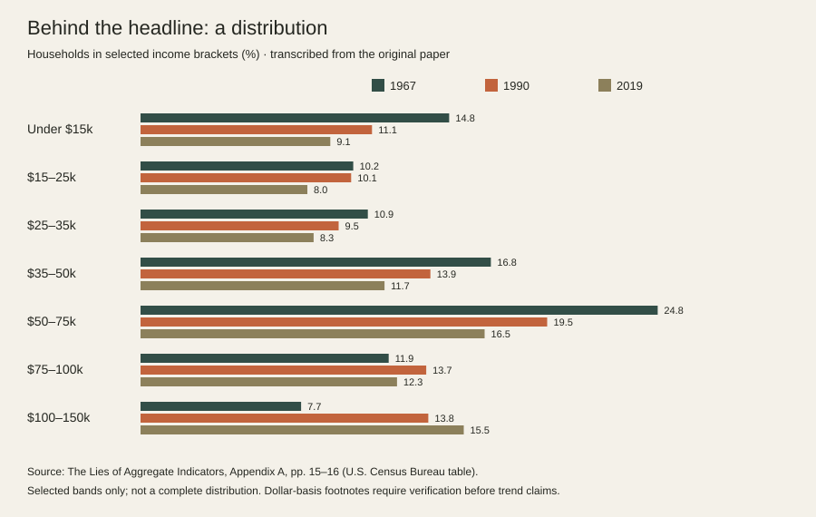

# The Lies of Aggregate Indicators

**Independent quantitative research · IB Mathematics: Applications & Interpretation HL**

[View the portfolio case study](https://arafid.github.io/projects/aggregate-indicators/)


## Overview

What can a household income distribution reveal that an aggregate indicator such as GDP leaves out?

This repository presents an independent mathematics investigation built around U.S. household-income distributions. The original paper examines how a single aggregate measure can hide the shape and spread of outcomes underneath it, then uses grouped income data to explore skewness, regression, model fit, and piecewise approximation.

The original 16-page paper is included unchanged in `docs/The-Lies-of-Aggregate-Indicators.pdf`. The other files are retrospective portfolio materials that make the work easier to review and clearly separate the original analysis from later documentation.

## Mathematical work in the original paper

The investigation includes:

- histogram-based descriptions of grouped household-income data;
- polynomial regression and discussion of residual error and R-squared;
- exponential fitting for the upper-income tail;
- a quadratic fit for the lower-income range;
- a quadratic/exponential piecewise approximation around the observed 1967 shape;
- discussion of normalization, model interpretability, and the limits of grouped data; and
- a negative-binomial shape considered as a possible comparison, without a completed simulation or validated negative-binomial model.

A central modeling lesson is that a strong overall fit can still miss the part of a distribution that matters most to the question. Local models can be easier to interpret, but they still require validation and careful treatment of assumptions.

## Selected appendix data

The chart below uses seven income bands transcribed from Appendix A of the paper for 1967, 1990, and 2019.



The values are percentages of households in named income brackets, not household-level observations. The available appendix excerpt does not reproduce the complete upper-income distribution or all methodology footnotes, so this repository does not impute missing brackets or present the chart as a complete real-income time series.

## Repository structure

```text
.
├── README.md
├── NOTICE.md
├── assets/
│   ├── income-brackets.svg
│   └── paper-preview.png
├── data/
│   └── selected-income-brackets.csv
└── docs/
    ├── The-Lies-of-Aggregate-Indicators.pdf
    ├── method-and-limitations.md
    └── paper-guide.md
```

## Read the project

- **Original paper:** [`docs/The-Lies-of-Aggregate-Indicators.pdf`](docs/The-Lies-of-Aggregate-Indicators.pdf)
- **Method and limitations:** [`docs/method-and-limitations.md`](docs/method-and-limitations.md)
- **Paper guide:** [`docs/paper-guide.md`](docs/paper-guide.md)
- **Selected appendix data:** [`data/selected-income-brackets.csv`](data/selected-income-brackets.csv)

## Tools and concepts

**Tools:** GeoGebra, Excel  
**Concepts:** regression, probability distributions, histograms, residual error, R-squared, piecewise functions, exponential models, quadratic models, model evaluation

## Project context

This work originated as an IB Mathematics: Applications & Interpretation HL investigation. It is presented here as an early quantitative-research project because the underlying question remains relevant to analytics: averages and headline KPIs can hide important differences inside a distribution.

The original working Excel and GeoGebra files referenced in the paper are not available in this repository, so no replacement coefficients, screenshots, or fit statistics have been fabricated. The original PDF remains the authoritative record of the analysis.
